  

<h1 align="center">Hi 👋, I'm Bayu Biantara</h1>

<h3 align="center">Full Stack Web Developer</h3>

  

Building reliable web applications with clean architecture and a smooth user experience.

---

<h2 align="center">🚀 About Me</h2>

**Bayu** here — a web developer from Indonesia 🇮🇩 who enjoys turning real business processes into working applications.

I mostly build full-stack apps with **Laravel** on the backend and **React + TypeScript** on the frontend, from HR tools like leave management to real-time chat.

Currently exploring **Laravel Reverb**, **clean architecture with Express + TypeScript**, and **Flutter** for mobile.

My goal is simple: write clean code, ship useful software, and keep learning every day.

 

<h2 align="center">🤝 Connect</h2>

  &nbsp;
  &nbsp;
  &nbsp;
  

<h2 align="center">💻 Tech Stack</h2>

   
  

<h2 align="center">🧩 Featured Projects</h2>

  
  
  
  

<h2 align="center">📊 GitHub Stats</h2>

  

<h2 align="center">📈 Activity Graph</h2>

  <picture>
    <source media="(prefers-color-scheme: dark)" srcset="https://raw.githubusercontent.com/bayubiantara0/bayubiantara0/output/github-snake-dark.svg" />
    
  </picture>

<h2 align="center">✍️ Dev Quote</h2>

  

Made with ☕ in Indonesia

